# Geometry figure gallery

26 illustrations. Rebuild all figures and attachments with `python scripts/make_figures.py`. Captions and problem links live in `manifest.json`. Most scenes use the [drawing skill](../skills/constant-width-geometry/SKILL.md); specialized diagrams use the renderers named in their scene JSON. See [authoring instructions](../docs/authoring.md#add-figures).

## Triangle radii

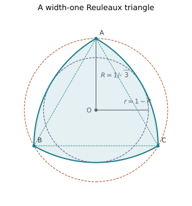

The incircle and circumcircle share the symmetry center; their radii sum to the width.

[Scene](scenes/triangle-radii.json) · Problems: [`cw-triangle-measures`](https://beniamin-bogosel.github.io/constant-width-problems/#cw-triangle-measures), [`cw-concentric-balls`](https://beniamin-bogosel.github.io/constant-width-problems/#cw-concentric-balls), [`cw-inradius-extrema`](https://beniamin-bogosel.github.io/constant-width-problems/#cw-inradius-extrema), [`cw-high-moment-counterexample`](https://beniamin-bogosel.github.io/constant-width-problems/#cw-high-moment-counterexample)

## Regular family

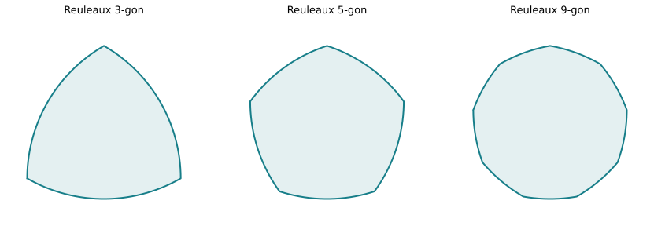

Regular Reuleaux polygons of width one; their areas increase toward the disk.

[Scene](scenes/regular-family.json) · Problems: [`cw-regular-reuleaux`](https://beniamin-bogosel.github.io/constant-width-problems/#cw-regular-reuleaux), [`cw-disk-maximizes-area`](https://beniamin-bogosel.github.io/constant-width-problems/#cw-disk-maximizes-area)

## Irregular pentagon

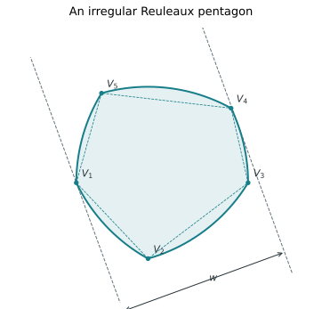

A perturbed and exactly closed unit-edge pentagram gives unequal boundary arc angles. The support lines remain one unit apart.

[Scene](scenes/irregular-pentagon.json) · Problems: [`cw-irregular-construction`](https://beniamin-bogosel.github.io/constant-width-problems/#cw-irregular-construction), [`cw-arc-polygon-area`](https://beniamin-bogosel.github.io/constant-width-problems/#cw-arc-polygon-area), [`cw-binormals`](https://beniamin-bogosel.github.io/constant-width-problems/#cw-binormals)

## Lens intersection

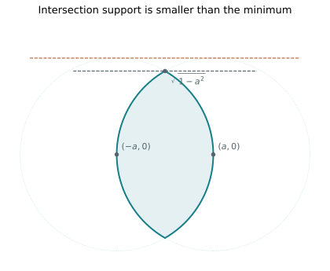

Two unit disks centered at ±a on the horizontal axis; here a=1/2.

[Scene](scenes/lens-intersection.json) · Problems: [`cw-intersection-trap`](https://beniamin-bogosel.github.io/constant-width-problems/#cw-intersection-trap)

## Smooth support

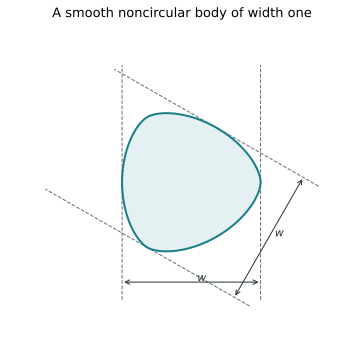

Support function h(θ)=1/2+0.045 cos(3θ); curvature radius stays positive.

[Scene](scenes/smooth-support.json) · Problems: [`cw-odd-harmonics`](https://beniamin-bogosel.github.io/constant-width-problems/#cw-odd-harmonics), [`cw-support-parametrization`](https://beniamin-bogosel.github.io/constant-width-problems/#cw-support-parametrization), [`cw-fourier-area`](https://beniamin-bogosel.github.io/constant-width-problems/#cw-fourier-area), [`cw-convexity-certificate`](https://beniamin-bogosel.github.io/constant-width-problems/#cw-convexity-certificate)

## Triangle erosion

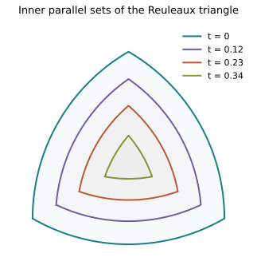

Erosion retains the three disk centers and reduces every disk radius from one to 1−t.

[Scene](scenes/triangle-erosion.json) · Problems: [`cw-erosion-disks`](https://beniamin-bogosel.github.io/constant-width-problems/#cw-erosion-disks), [`cw-regular-inner-parallel`](https://beniamin-bogosel.github.io/constant-width-problems/#cw-regular-inner-parallel), [`cw-perimeter-to-area`](https://beniamin-bogosel.github.io/constant-width-problems/#cw-perimeter-to-area), [`cw-cheeger-root`](https://beniamin-bogosel.github.io/constant-width-problems/#cw-cheeger-root), [`cw-cheeger-bisection`](https://beniamin-bogosel.github.io/constant-width-problems/#cw-cheeger-bisection), [`cw-cheeger-extrema`](https://beniamin-bogosel.github.io/constant-width-problems/#cw-cheeger-extrema), [`cw-covering-center-locus`](https://beniamin-bogosel.github.io/constant-width-problems/#cw-covering-center-locus)

## Pal hexagon

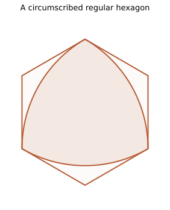

Six equally spaced supporting lines can be chosen at equal distance from a common center.

[Scene](scenes/pal-hexagon.json) · Problems: [`cw-pal-hexagon`](https://beniamin-bogosel.github.io/constant-width-problems/#cw-pal-hexagon), [`cw-blaschke-lebesgue`](https://beniamin-bogosel.github.io/constant-width-problems/#cw-blaschke-lebesgue), [`cw-symmetric-cover`](https://beniamin-bogosel.github.io/constant-width-problems/#cw-symmetric-cover)

## Outer parallel

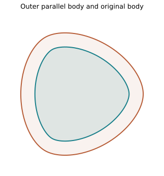

Adding a radius-0.15 disk adds 0.15 to the support function and 0.30 to the width.

[Scene](scenes/outer-parallel.json) · Problems: [`cw-steiner-parallel`](https://beniamin-bogosel.github.io/constant-width-problems/#cw-steiner-parallel)

## Dual edge helpers

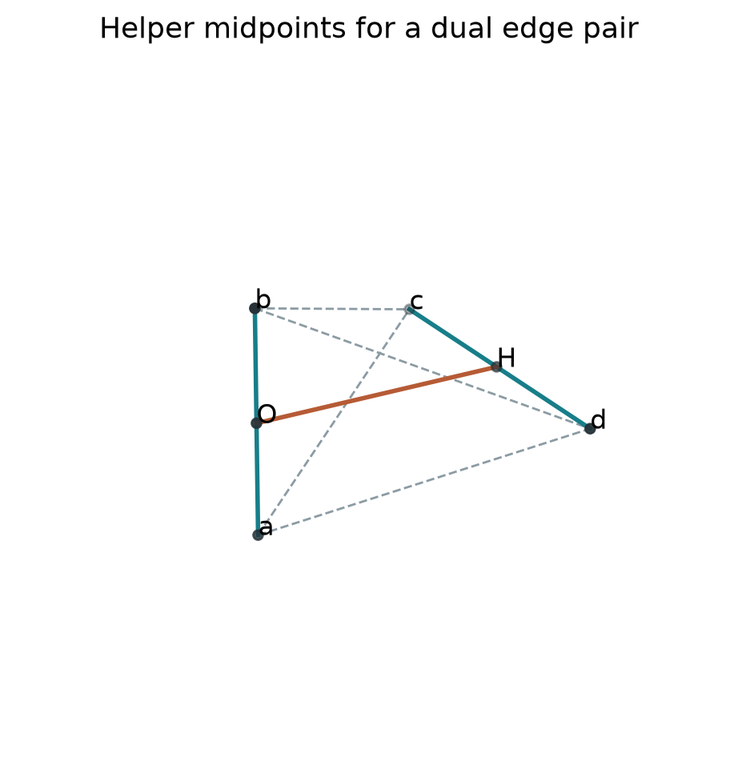

The midpoints O and H reduce the four cross-distance constraints to h²+u²+v²=1.

[Scene](scenes/dual-edge-helpers.json) · Problems: [`cw-dual-edge-coordinates`](https://beniamin-bogosel.github.io/constant-width-problems/#cw-dual-edge-coordinates), [`cw-dual-dihedral`](https://beniamin-bogosel.github.io/constant-width-problems/#cw-dual-dihedral), [`cw-extremal-bookkeeping`](https://beniamin-bogosel.github.io/constant-width-problems/#cw-extremal-bookkeeping)

## Meissner two types

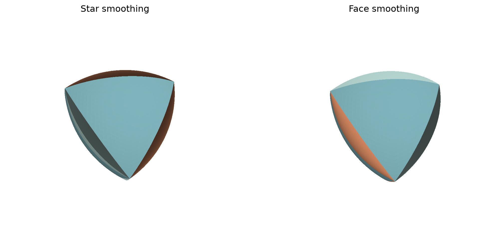

Spherical patches are blue, wedges pale green, and spindle patches orange. Both choices have the same exact area and volume. Triangulated illustrations.

[Scene](scenes/meissner-two-types.json) · Problems: [`cw-meissner-tetra-volume`](https://beniamin-bogosel.github.io/constant-width-problems/#cw-meissner-tetra-volume), [`cw-tetra-smoothings`](https://beniamin-bogosel.github.io/constant-width-problems/#cw-tetra-smoothings), [`cw-open-meissner`](https://beniamin-bogosel.github.io/constant-width-problems/#cw-open-meissner), [`cw-blaschke-volume`](https://beniamin-bogosel.github.io/constant-width-problems/#cw-blaschke-volume)

## Spherical helper

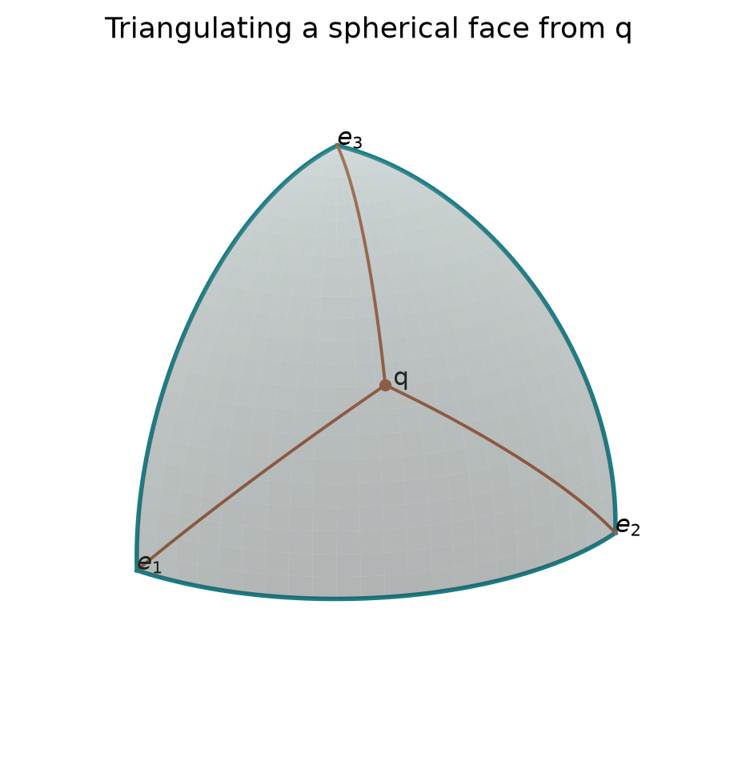

An auxiliary interior point divides the spherical octant into three geodesic triangles.

[Scene](scenes/spherical-helper.json) · Problems: [`cw-spherical-helper`](https://beniamin-bogosel.github.io/constant-width-problems/#cw-spherical-helper), [`cw-spherical-partition-check`](https://beniamin-bogosel.github.io/constant-width-problems/#cw-spherical-partition-check)

## Spindle generator

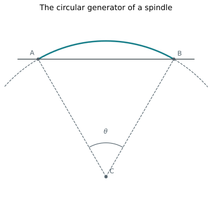

Rotate the minor arc AB around its chord; the distance from C to the chord is cos(θ/2).

[Scene](scenes/spindle-generator.json) · Problems: [`cw-spindle-area`](https://beniamin-bogosel.github.io/constant-width-problems/#cw-spindle-area)

## Mixed skeleton tangents

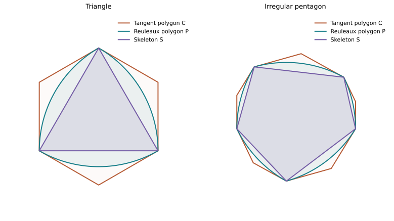

The skeleton S lies inside P, which lies inside the endpoint-tangent polygon C. Every convex K between S and C has the same reflected mixed area. Both panels have width-one Reuleaux polygons.

[Scene](scenes/mixed-skeleton-tangents.json) · Problems: [`cw-triangle-hexagon-plateau`](https://beniamin-bogosel.github.io/constant-width-problems/#cw-triangle-hexagon-plateau), [`cw-reuleaux-skeleton-plateau`](https://beniamin-bogosel.github.io/constant-width-problems/#cw-reuleaux-skeleton-plateau), [`cw-skeleton-difference-area`](https://beniamin-bogosel.github.io/constant-width-problems/#cw-skeleton-difference-area), [`cw-skeleton-area-extrema`](https://beniamin-bogosel.github.io/constant-width-problems/#cw-skeleton-area-extrema), [`cw-polygon-mixed-edge-sum`](https://beniamin-bogosel.github.io/constant-width-problems/#cw-polygon-mixed-edge-sum)

## Symmetric hull annulus

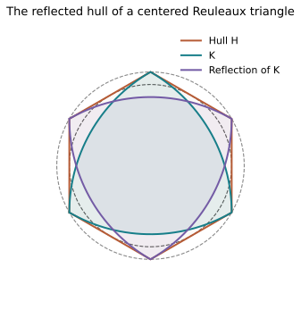

The hull H is a regular hexagon between concentric circles of radii 1/2 and 1/√3. The inner disk belongs to the hull, not necessarily to either Reuleaux triangle.

[Scene](scenes/symmetric-hull-annulus.json) · Problems: [`cw-convex-hull-mixed-identity`](https://beniamin-bogosel.github.io/constant-width-problems/#cw-convex-hull-mixed-identity), [`cw-planar-hull-objective`](https://beniamin-bogosel.github.io/constant-width-problems/#cw-planar-hull-objective), [`cw-symmetric-hull-annulus`](https://beniamin-bogosel.github.io/constant-width-problems/#cw-symmetric-hull-annulus), [`cw-annulus-both-constraints`](https://beniamin-bogosel.github.io/constant-width-problems/#cw-annulus-both-constraints)

## Three in unit disk

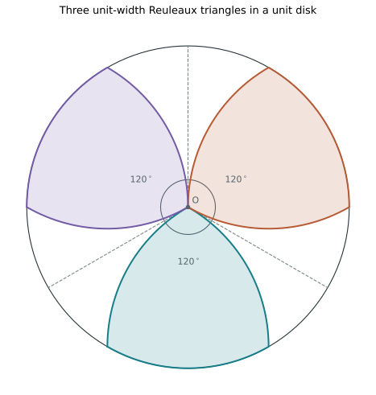

Three translates share only the disk center O. Their tangent sectors have angle 120° and partition the full angle; the curved bodies leave gaps farther from O. Boundary contacts are allowed.

[Scene](scenes/three-in-unit-disk.json) · Problems: [`cw-unit-disk-packing`](https://beniamin-bogosel.github.io/constant-width-problems/#cw-unit-disk-packing), [`cw-common-point-packing`](https://beniamin-bogosel.github.io/constant-width-problems/#cw-common-point-packing), [`cw-fixed-shape-disk-packing`](https://beniamin-bogosel.github.io/constant-width-problems/#cw-fixed-shape-disk-packing)

## Two translates in disk

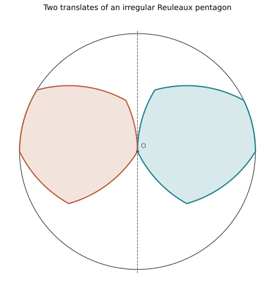

Moving each endpoint of a diameter to O gives two translates in the unit disk. They lie on opposite sides of a common supporting line and touch only at O.

[Scene](scenes/two-translates-in-disk.json) · Problems: [`cw-fixed-shape-disk-packing`](https://beniamin-bogosel.github.io/constant-width-problems/#cw-fixed-shape-disk-packing), [`cw-translate-collision`](https://beniamin-bogosel.github.io/constant-width-problems/#cw-translate-collision), [`cw-enclosing-ball-core`](https://beniamin-bogosel.github.io/constant-width-problems/#cw-enclosing-ball-core)

## Distance functions

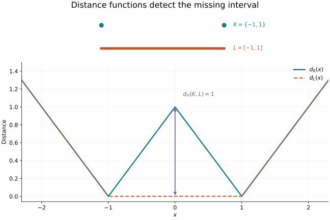

The endpoints and the filled interval have the same convex hull and support function, but different distance functions. Their Hausdorff distance is one, attained by the distance-function gap at x=0.

[Scene](scenes/distance-functions.json) · Problems: [`cw-distance-function-basics`](https://beniamin-bogosel.github.io/constant-width-problems/#cw-distance-function-basics), [`cw-hausdorff-distance-functions`](https://beniamin-bogosel.github.io/constant-width-problems/#cw-hausdorff-distance-functions), [`cw-hausdorff-support`](https://beniamin-bogosel.github.io/constant-width-problems/#cw-hausdorff-support)

## Grid domain topologies

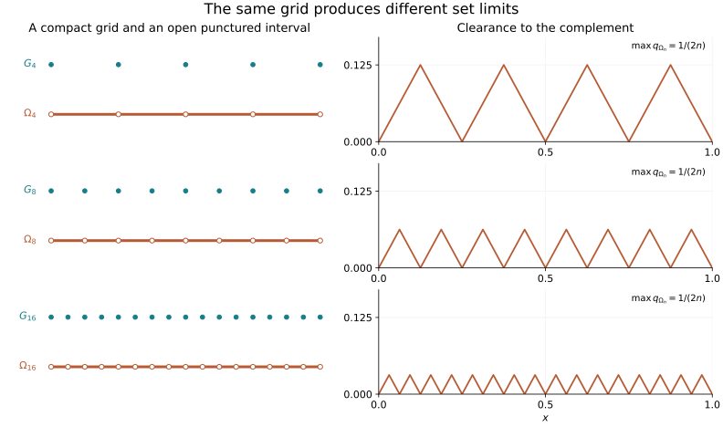

Filled dots represent G_n; hollow dots are removed from the open interval Ω_n. As n grows, the compact grids fill [0,1], while the domain clearances shrink uniformly to zero. Removed points are shown with enlarged markers, not positive-length holes.

[Scene](scenes/grid-domain-topologies.json) · Problems: [`cw-grid-topology-counterexample`](https://beniamin-bogosel.github.io/constant-width-problems/#cw-grid-topology-counterexample), [`cw-complementary-hausdorff`](https://beniamin-bogosel.github.io/constant-width-problems/#cw-complementary-hausdorff), [`cw-domain-interior-persistence`](https://beniamin-bogosel.github.io/constant-width-problems/#cw-domain-interior-persistence), [`cw-convex-boundary-distance`](https://beniamin-bogosel.github.io/constant-width-problems/#cw-convex-boundary-distance)

## Blaschke two vertex

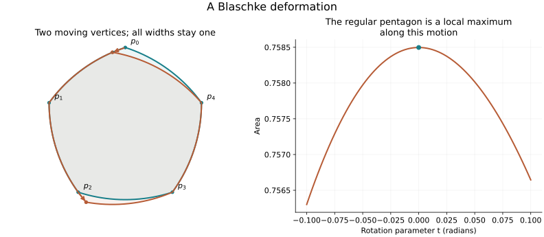

An exact two-vertex Blaschke motion of the regular width-one pentagon. Blue is the initial body, orange the perturbed body. Areas are computed by circular-arc integration; the plot illustrates, rather than proves, the negative second variation.

[Scene](scenes/blaschke-two-vertex.json) · Problems: [`cw-arc-normal-integral`](https://beniamin-bogosel.github.io/constant-width-problems/#cw-arc-normal-integral), [`cw-blaschke-two-vertex-motion`](https://beniamin-bogosel.github.io/constant-width-problems/#cw-blaschke-two-vertex-motion), [`cw-blaschke-negative-second-variation`](https://beniamin-bogosel.github.io/constant-width-problems/#cw-blaschke-negative-second-variation), [`cw-reuleaux-finite-compactness`](https://beniamin-bogosel.github.io/constant-width-problems/#cw-reuleaux-finite-compactness)

## Smallest arc removal

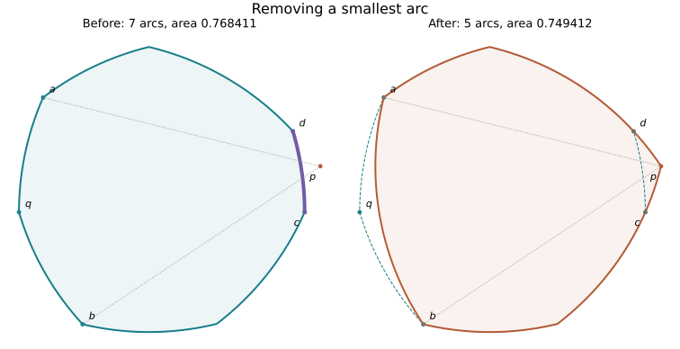

A shortest arc cd (purple) and opposite corner q are replaced using the unit-circle intersection p. The new body has five arcs; c and d become smooth points. Dashed blue is the previous boundary. Both bodies are constructed and checked as width-one Reuleaux polygons.

[Scene](scenes/smallest-arc-removal.json) · Problems: [`cw-shortest-arc-chord-lemma`](https://beniamin-bogosel.github.io/constant-width-problems/#cw-shortest-arc-chord-lemma), [`cw-smallest-arc-removal`](https://beniamin-bogosel.github.io/constant-width-problems/#cw-smallest-arc-removal), [`cw-polygon-descent-limit`](https://beniamin-bogosel.github.io/constant-width-problems/#cw-polygon-descent-limit)

## Equiangular supports

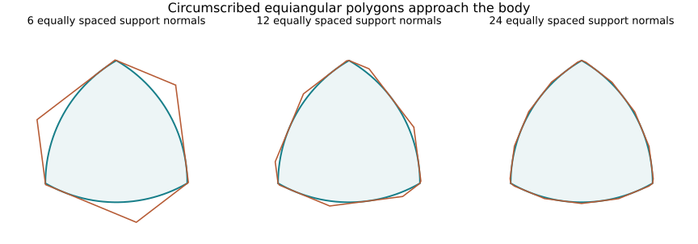

The same Reuleaux triangle inside intersections of 6, 12 and 24 equally spaced supporting half-planes. At a corner several successive support lines can meet at one point, producing zero-length sides in the indexed polygon.

[Scene](scenes/equiangular-supports.json) · Problems: [`cw-equiangular-support-perimeter`](https://beniamin-bogosel.github.io/constant-width-problems/#cw-equiangular-support-perimeter), [`cw-equiangular-area-quadratic`](https://beniamin-bogosel.github.io/constant-width-problems/#cw-equiangular-area-quadratic), [`cw-equiangular-mesh-error`](https://beniamin-bogosel.github.io/constant-width-problems/#cw-equiangular-mesh-error), [`cw-reuleaux-approximation-support-splice`](https://beniamin-bogosel.github.io/constant-width-problems/#cw-reuleaux-approximation-support-splice)

## Hexagon strip sliding

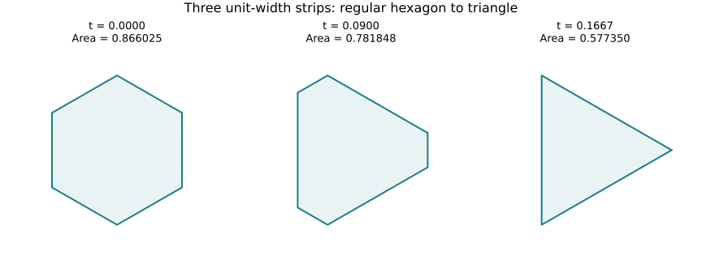

Opposite supports remain one unit apart while the three strips slide. At the endpoint three sides vanish and an equilateral triangle remains. These straight-sided polygons are not constant-width bodies.

[Scene](scenes/hexagon-strip-sliding.json) · Problems: [`cw-hexagon-strip-sliding`](https://beniamin-bogosel.github.io/constant-width-problems/#cw-hexagon-strip-sliding), [`cw-pal-hexagon`](https://beniamin-bogosel.github.io/constant-width-problems/#cw-pal-hexagon)

## Shortest arc caps

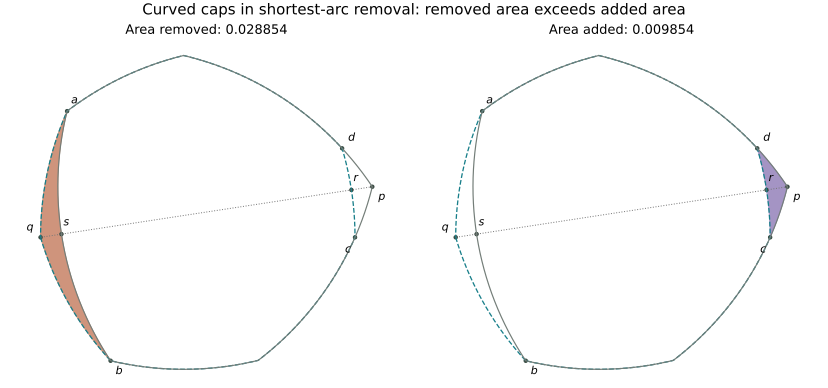

The orange region is removed near q and the purple region is added near p. The line pq splits them into the paired curvilinear pieces used in the comparison lemma. Their boundaries include circular arcs, so straight-triangle areas would give the wrong subtraction. Dashes show the original boundary; the solid gray curve is the replacement.

[Scene](scenes/shortest-arc-caps.json) · Problems: [`cw-smallest-arc-removal`](https://beniamin-bogosel.github.io/constant-width-problems/#cw-smallest-arc-removal)

## Switching support curvature

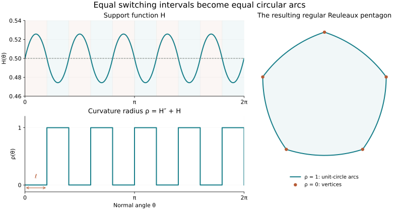

A piecewise analytic support function for a width-one regular Reuleaux pentagon. Equal intervals alternate between curvature radius zero and one: zero intervals map to single vertices, while unit intervals trace unit-circle arcs. Curvature values at the finitely many jumps are immaterial.

[Scene](scenes/switching-support-curvature.json) · Problems: [`cw-curvature-bang-bang`](https://beniamin-bogosel.github.io/constant-width-problems/#cw-curvature-bang-bang), [`cw-variational-switching-rule`](https://beniamin-bogosel.github.io/constant-width-problems/#cw-variational-switching-rule), [`cw-switching-ode-regularity`](https://beniamin-bogosel.github.io/constant-width-problems/#cw-switching-ode-regularity), [`cw-blaschke-lebesgue-variational`](https://beniamin-bogosel.github.io/constant-width-problems/#cw-blaschke-lebesgue-variational)

## Curvature aliasing

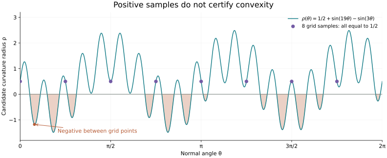

For N=8 and k=2N+3=19, the two sine modes agree at every grid direction, so all sampled curvature values are 1/2. Between them the candidate curvature is negative on open intervals. This function cannot be the curvature radius of a convex support function despite passing the sampled inequalities.

[Scene](scenes/curvature-aliasing.json) · Problems: [`cw-grid-failure`](https://beniamin-bogosel.github.io/constant-width-problems/#cw-grid-failure), [`cw-convexity-certificate`](https://beniamin-bogosel.github.io/constant-width-problems/#cw-convexity-certificate)

## Mixed segment sweep

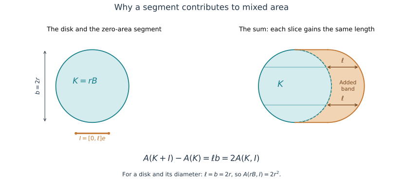

Adding a horizontal segment of length ℓ extends every nonempty horizontal slice by ℓ. The shaded curved band therefore has area ℓb, where b is the perpendicular width. For a radius-r disk and its diameter segment, ℓ=b=2r, giving mixed area 2r² despite the segment having zero area. Circle arcs are sampled only for rendering.

[Scene](scenes/mixed-segment-sweep.json) · Problems: [`cw-segment-mixed-area`](https://beniamin-bogosel.github.io/constant-width-problems/#cw-segment-mixed-area), [`cw-valuation-segment-correction`](https://beniamin-bogosel.github.io/constant-width-problems/#cw-valuation-segment-correction)
